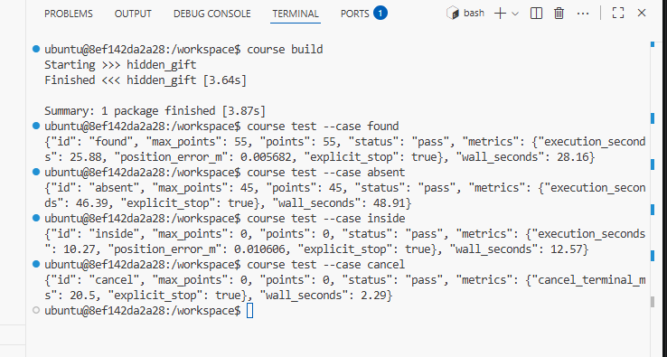

# L01 · краткая проверка

Заполните этот файл и закоммитьте его вместе с решением. Достаточно 5–10 строк
собственных ответов вместо текста в угловых скобках.

## Обязательные тесты

- `course test --case found` — <Тесты пройдены, позиционная ошибка меньше ожидаемой 0.005682 < 0.05> {"execution_seconds": 25.88, "position_error_m": 0.005682, "explicit_stop": true}, "wall_seconds": 28.16
- `course test --case absent` — <Тесты пройдены, карта проверена целиком(время заметно больше) и подарок не найдее> 
{"execution_seconds": 46.39, "explicit_stop": true}, "wall_seconds": 48.91

## Бонусы
- `course test --case inside` - <Тесты пройдены, позиционная ошибка выше чем в обычном поиске, но не превышает необходимой 0.01060 < 0.05. Время затраченное на оценку заметно меньше> "metrics": {"execution_seconds": 10.27, "position_error_m": 0.010606, "explicit_stop": true}, "wall_seconds": 12.57
- `course test --case cancel` - <Тесты пройдены, время затрачено минимально, вызвана остановка>  "metrics": {"cancel_terminal_ms": 20.5, "explicit_stop": true}, "wall_seconds": 2.29
## Граница решения

- <Не учтён шум. С шумом не получится найти центр, как минимум с заданным ограничением точности>

## Использование LLM

- Использование: `Использован LLM для составления гайдбука. В нём суммаризировано описаны основные моменты по ROS2, такие как actions,topics, messages и т.д., а также команды для исследовования нод и пробного запуска робота по траектории математических функций `
- Проверка: `LLM не применён, все проверки проведены и описаны вручную`

Это обязательная краткая запись самопроверки. Баллы определяет поведение решения
в тестах `found` и `absent`.
